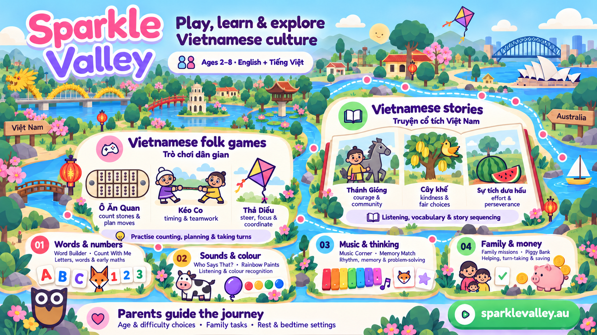
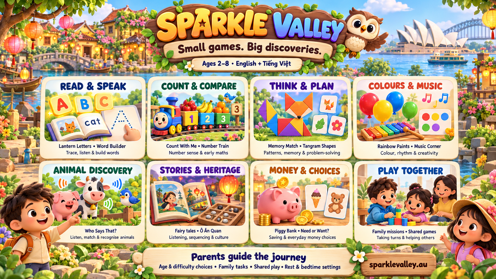
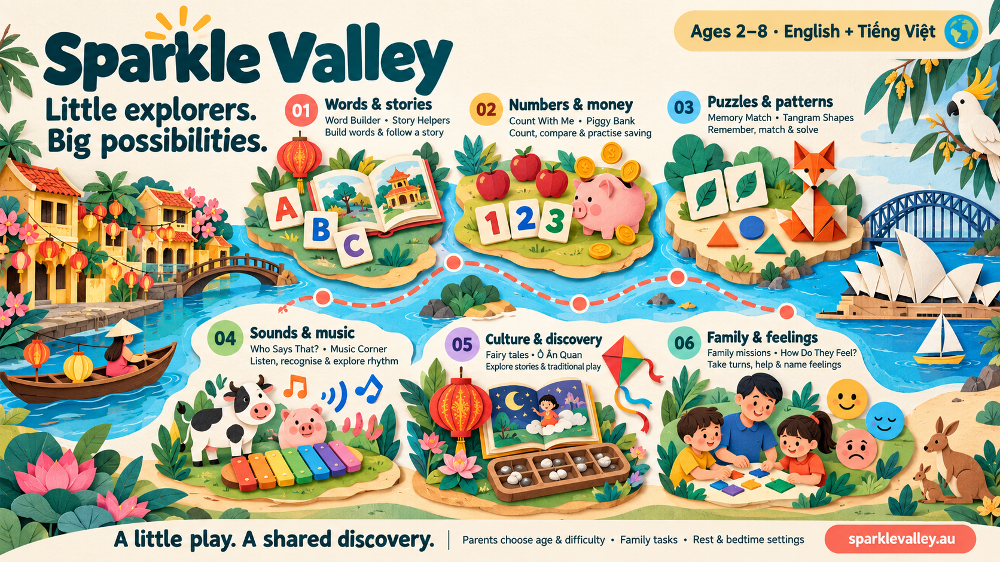
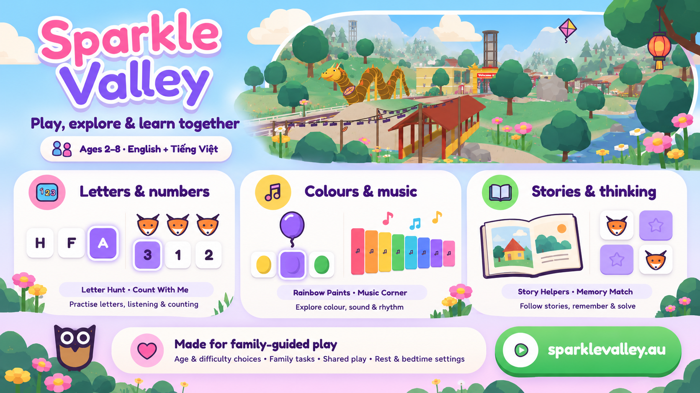

# Sparkle Valley: games and learning showcase

Created 22 October 2026 AEDT at the owner's request, using the GitHub project: [nguyentuanphu/Sparkle-Valley](https://github.com/nguyentuanphu/Sparkle-Valley).

[Download the combined banner](sparkle-valley-combined-heritage.png) · [Combined copy and Vietnamese learning notes](combined.md) · [Original wording](copy.md)

The landscape banners introduce the game to parents of children aged 2–8. They present named activities, the actions children take, skills they can practise and ways parents can guide play. The combined design brings together the adventure-map arrangement and the game's UI/art identity, with larger sections for Vietnamese folk games and stories. These are promotional compositions, not screenshots of a live banner interface.

The updated combined background clearly places Vietnam on the left with Cầu Rồng, Hồ Gươm/Tháp Rùa and Chùa Một Cột, and Australia on the right with Sydney Opera House and Sydney Harbour Bridge.

## Designs and combined banner

The current combined design follows the owner's request to combine themes 2 and 3, use the game references, and add more information about Vietnamese folk games and stories. The earlier options are preserved for comparison. All designs use the source-backed feature and learning information below, with different selections of examples.

| Theme | Direction | Download |
| --- | --- | --- |
| Combined: Learning and Vietnamese heritage | Adventure-map journey with the actual game identity, three named folk games, three named stories and four broader learning groups | [Combined PNG](sparkle-valley-combined-heritage.png) |
| 1. Storybook Valley | Bright illustrated world, wooden brand sign, eight activity panels | [Original PNG](sparkle-valley-learning-banner.png) |
| 2. Paper Trail Adventure | Layered paper-cut landscape, deep teal headings, a winding journey through six learning groups | [Theme 2 PNG](theme-2-paper-trail.png) |
| 3. In the Game | Actual game identity: pink/purple title, blue/lilac gradient, rounded white cards, outlined icons and the flat owl | [Theme 3 PNG](theme-3-game-ui.png) |

### Original: Storybook Valley

### Theme 2: Paper Trail Adventure

This independent creative direction groups words and stories, numbers and money, puzzles and patterns, sounds and music, culture and discovery, and family and feelings along a river journey.

### Theme 3: In the Game

This promotional composition follows the game's existing visual identity. Its references are the real title, counting, colours, music and valley screenshots listed in [the theme notes](themes.md). It is a designed banner, rather than an unmodified game screenshot.

[Theme copy and art references](themes.md)

## Games, play and practice

These are examples from the current catalogue and reading menu, rather than a promise that every activity appears for every age or setting.

| Area | Games or activities | What children do | Skills they practise |
| --- | --- | --- | --- |
| Letters and first words | Lantern Letters, Sound Pond, Word Builder, First Sounds | Trace letters, match a spoken sound to a letter or picture, and assemble words | Letter recognition, sound awareness and early word building |
| Reading and comprehension | Read With Me, Word and Picture, Sentence Train, Story Choices, Story Helpers | Follow highlighted narration, match words to pictures, build sentences, and help in story pictures | Vocabulary, listening, sequencing and understanding a story |
| Numbers and early maths | Count With Me, Number Train, More or Less?, Add It Up | Count objects, order numbers, compare amounts, and solve small sums | Number sense, comparison and early arithmetic |
| Shapes and visual thinking | Shadow Shapes, Small to Big, Tangram Shapes, Photo Puzzle | Match silhouettes, order sizes, fit shapes and assemble pictures | Shape recognition, spatial reasoning and observation |
| Memory and planning | Memory Match, What Comes Next?, Robot Planner, Find the Rule | Remember matching cards, complete patterns, and plan a sequence of steps | Recall, pattern recognition and problem-solving |
| Colours and music | Rainbow Paints, Music Corner, Copy the Tune | Identify colours, explore musical sounds and repeat a tune | Colour recognition, listening, rhythm and creative exploration |
| Animals | Who Says That?, Feed the Bunny, Odd One Out | Listen to an animal recording, choose its picture, match food and notice differences | Animal vocabulary, sound recognition and classification |
| Stories and heritage | Fairy tales, Water Puppets, Ô Ăn Quan, Kite Flying | Listen to stories, explore cultural activities and play traditional games | Language and cultural familiarity; counting and planning in Ô Ăn Quan |
| Money and shopping | Piggy Bank, Need or Want?, Three Jars, Little Shopkeeper, Shopping List | Count game money, save toward an amount, sort needs and wants, and make shopping choices | Money recognition, counting, saving and everyday decision-making |
| Family and feelings | Family missions, How Do They Feel?, shared games | Complete a parent-set task, discuss picture situations and take turns | Naming feelings, cooperation and helping others |
| Time and routines | What's the Time?, Days of the Week | Match times and put days in order | Familiarity with time and daily routines |
| Outdoor and travel play | Hopscotch, Tug of War, Harbour Ferries, Tram Stops | Play picture-based challenges and explore routes and landmarks | Turn-taking, attention and familiarity with places and transport |

## How parents can guide play

- Choose age and difficulty settings so activities suit the child; available activities vary with age and enabled settings.
- Use the game's English and Vietnamese options to explore familiar words in either language.
- Set family tasks and messages; a grown-up confirms real-life task completion with the child.
- Play alongside a child or use supported shared games. Two-player and online features depend on the activity and family settings.
- Set rest and bedtime options to support the family's routine.

The banner describes opportunities for practice, rather than guaranteed learning outcomes. Rainbow Paints is a colour-recognition activity; this design does not advertise the unfinished ten drawing games as available. Money games use pretend game currency; their appearance depends on age and settings.

## Source and review record

Source snapshot: GitHub `main`, commit [`de8cc0edbecac65fbe7213cf1527187d70fbdfba`](https://github.com/nguyentuanphu/Sparkle-Valley/tree/de8cc0edbecac65fbe7213cf1527187d70fbdfba).

- [Game names and loaders](../../js/games/catalog.js)
- [Activity groups and age metadata](../../js/content/activities.js)
- [Reading games](../../js/games/readingmenu.ts)
- [Animal-sound game](../../js/games/learning.js)
- [Money games](../../js/games/money.js)
- [Vietnamese folk-game rules](../../js/games/vietnam.js) and [kite game](../../js/games/folk2.js)
- [Vietnamese stories and narration](../../js/tales-content.js)
- [Existing feature and parent-control descriptions](../../marketing/ads-r82/README.md)

Game names and the featured parent controls were checked against these sources. The generated artwork was reviewed visually for spelling, layout, and agreement with [copy.md](copy.md). The PNG is 1672 × 941 pixels. This is an artwork/documentation change; it does not change the game, its version or its deployment.

Validation on 22 October 2026 AEDT:

- Visual review: banner wording and all eight panels inspected.
- Local document links: 10 valid; `git diff --check` passed.
- `cd tests && node suite.mjs --changed --jobs 1`: emoji, preload, arch, unit (175 tests), names, bilingual, rules and types passed. The `noemoji` check initially failed with `ERR_CONNECTION_REFUSED` after the background preview server stopped.
- After starting a persistent server, `node suite.mjs --jobs 1 --only noemoji` passed (297 seconds; 100 games and the checked interface screens). All nine selected checks therefore passed; `noemoji` needed this second attempt.

For the two additional themes and the combined heritage design, see [artwork review](themes.md#artwork-review) and [follow-up validation](combined.md#review-and-validation). The follow-up's selected suite passed 9/9 with no retries.
